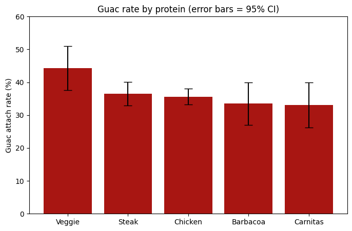
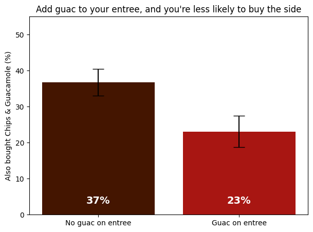

# Chipotle Guac Hypothesis: Do Steak Customers Add the Most Guac?

An independent analysis of 4,622 public Chipotle order items, testing a hypothesis I formed while working at Chipotle: that steak customers are the most likely to add guacamole.

> Independent project using public data. Not official Chipotle data or analysis.

## Question
Are steak customers more likely to add guacamole than customers who order other proteins? And how does guac bought as an entree add-on relate to guac bought as a separate Chips & Guacamole side?

## Key Findings

- **Guac matters.** About 59% of orders with an entree (1,832 orders) included guacamole in some form, versus 43% if you count only entree add-ons. Counting add-ons alone understates guac demand by roughly 16 percentage points.
- **The steak hypothesis was not supported.** Steak customers added guac slightly more often than barbacoa customers (36.5% vs 33.5%), but the gap is within the range of chance (p = 0.49, 95% CI: -4.4 to +10.4 points). The four meats (steak, chicken, barbacoa, carnitas) could not be told apart (p = 0.78).
- **Veggie orders stood out (exploratory finding).** Veggie orders included guac 8.8 points more often than meat orders (44% vs 35.5%, 95% CI: 1.9 to 15.7, p = 0.013). This was noticed first and tested second, so it should be confirmed with new data.
  - *Data vs. my experience:* as I remember it, guac on a veggie bowl was free when I worked at Chipotle, but this dataset prices it as an add-on (about +$2.50 on bowls). Policies may have changed since the data was collected.
- **The two ways of buying guac compete.** Among 991 single-entree orders, 37% of customers without entree guac also bought the Chips & Guacamole side, versus 23% of those who added guac to their entree (13.7-point gap, 95% CI: 8.0 to 19.5, p < 0.001). Across all orders the gap is smaller (5.6 points, 95% CI: 1.6 to 9.6).
- **Business scenario.** At the $2.50 add-on price, each meat entree earns about $0.89 in guac revenue. If meat orders matched the veggie rate, that would be roughly $48 to $392 more per 1,000 entrees. The side revenue given up by customers who add guac to a single entree is roughly a quarter of the add-on price (about $0.61 per order at the median $4.45 side price). These are scenarios, not forecasts.

## Recommendation
Targeting steak customers would not pay off, since the data shows no reliable difference between proteins. A better test is an "add guac?" prompt aimed at the roughly 41% of orders with no guac in any form, validated with an A/B test before any rollout.

## Charts

*Black lines show 95% confidence ranges.*

## Methods
- **Tools:** Python, pandas, NumPy, SciPy, matplotlib (run in Google Colab).
- **Unit of analysis:** Each row in the dataset is one item, not one order. For protein comparisons, I kept only entrees (burritos, bowls, tacos, salads) and extracted the protein from the item name. For the chips-and-guac analysis, I collapsed the data to one row per order.
- **Guac definition:** An entree "has guac" if its choice description contains "Guacamole". "Guac in any form" means an order had guac on at least one entree or included the Chips & Guacamole side.
- **Tests:** Chi-square tests of independence for group differences, and 95% confidence intervals for differences in proportions (normal approximation).
- **Robustness checks:** Protein results were consistent when weighting by quantity. The substitution effect held, and grew stronger, when restricted to single-entree orders.

## Limitations
- Results show association, not causation.
- Figures are revenue, not profit. The data has no cost information.
- The data is several years old, so prices and policies may differ today.
- Orders with several entrees may be group orders, and the side is often shared. The substitution result is strongest in single-entree orders.
- The side rate dips unexpectedly in 2-entree orders (about 16%, versus 32% and 30% for 1 and 3+ entrees). I do not have an explanation for this.
- Barbacoa (n = 203) and veggie (n = 212) are small samples, so their estimates are less precise.
- Orders with several entrees count as having guac if any entree has it, and quantity was ignored in the order-level analysis.

## Data
Public Chipotle orders dataset (`chipotle.tsv`, 4,622 rows, 5 columns), loaded from:
https://raw.githubusercontent.com/justmarkham/DAT8/master/data/chipotle.tsv

This is a widely used teaching dataset. I did not verify its original source or collection date.

## How to Run
1. Clone the repo.
2. Install the libraries: `pip install pandas numpy scipy matplotlib`
3. Open `chipotle_guac_hypothesis.ipynb` and run all cells in order. The data loads directly from the URL above.

## Author
Suprajaa Asaithambi | [LinkedIn](https://www.linkedin.com/in/suprajaa-asaithambi/)
